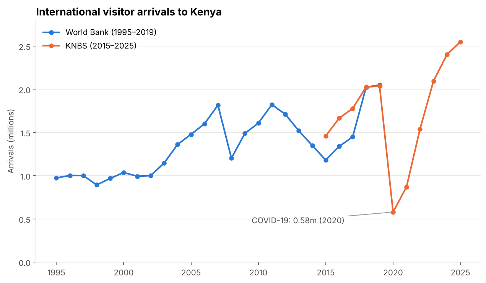
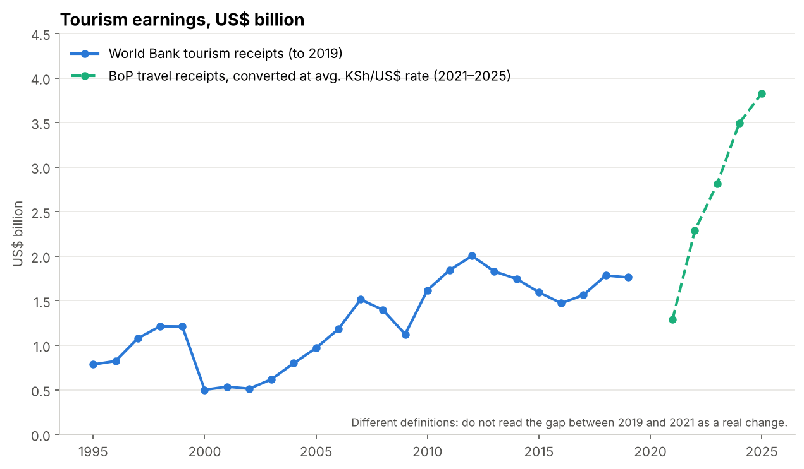
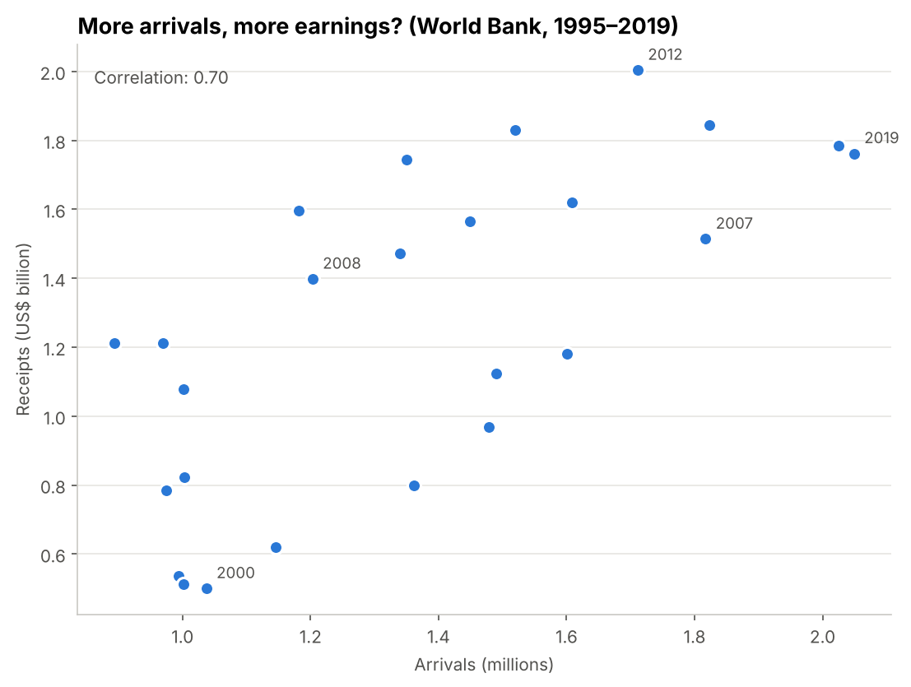
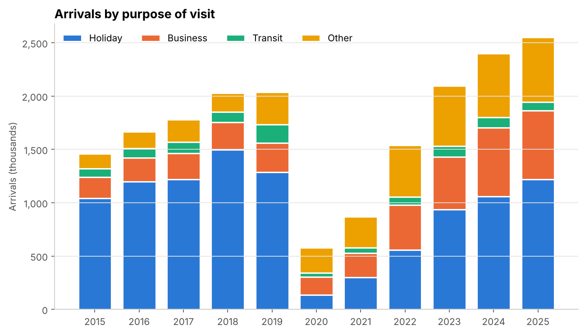
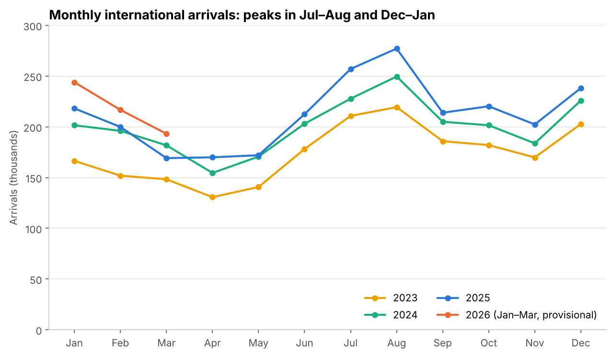
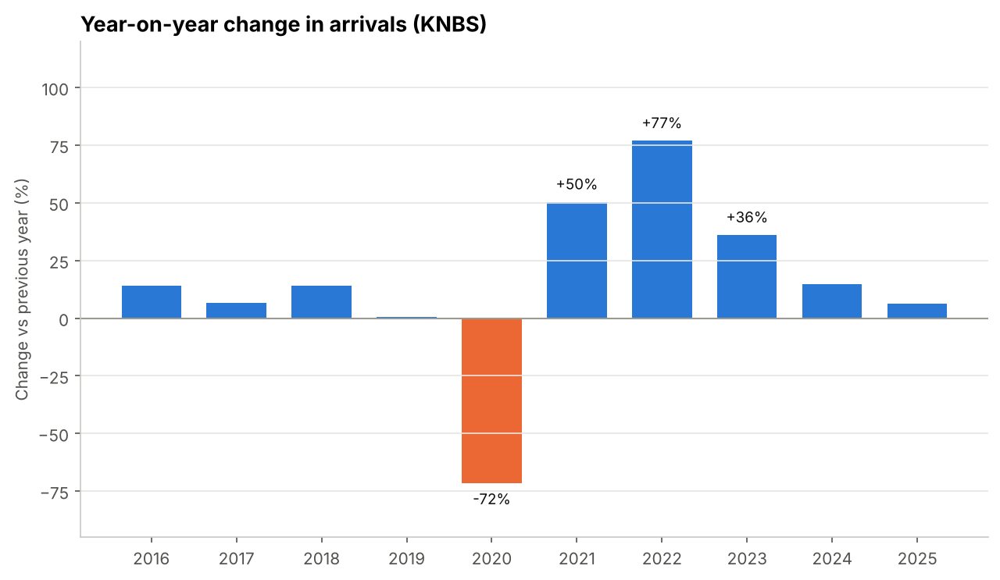

# Kenya Tourism Analysis, 1995–2025

  [](https://colab.research.google.com/github/Ireneooko/kenya-tourism-analysis/blob/main/kenya_tourism_analysis.ipynb)

How has Kenya's tourism sector changed over three decades, and how fully has it recovered from COVID-19? This project analyses international visitor arrivals and tourism earnings over the long run (1995–2019), the 2020 collapse and the recovery to 2025, with monthly seasonality through March 2026.

## Key findings

- **Arrivals have fully recovered.** KNBS counted 2.55 million international arrivals in 2025, up 6.2% on 2024 and 25.3% above 2019 (2.04 million). Arrivals fell 71.5% in 2020.
- **The visitor mix has shifted.** Holiday travel was 63.3% of arrivals in 2019 and 47.8% in 2025. Business (25.2%) and "Other" (23.7%, which includes visiting friends and relatives) now carry much more weight.
- **Seasonality is consistent.** August was the busiest month in each of 2023, 2024 and 2025, and arrivals are lowest in March–April (April in 2023 and 2024, March in 2025). Aug 2025 (277,155) was the busiest month and Mar 2025 (169,178) the quietest; the 2025 monthly figures are provisional.
- **Early 2026 is ahead of last year.** January–March 2026 arrivals were 653,919, +11.3% on the same months of 2025 (provisional).
- **Arrivals and earnings move together, but loosely.** The correlation is 0.70 for 1995–2019 (World Bank data). Both series trend upward over the period, so this partly reflects shared growth rather than a tight year-to-year link.
- **Earnings have grown sharply since 2021.** Balance-of-payments travel receipts rose from KSh 141.6 bn (2021) to KSh 494.7 bn (2025), about US$1.3 bn to US$3.8 bn at average exchange rates. The 2021 starting point is a pandemic-depressed base.

## Charts

| | |
|---|---|
|  |  |
|  |  |
|  |  |

## Data sources

| File | Source |
|---|---|
| `arrivals.csv` | World Bank WDI `ST.INT.ARVL` (Kenya, 1995–2019); KNBS Economic Survey 2026, Table 12.2 (2015–2025) |
| `earnings.csv` | World Bank WDI `ST.INT.RCPT.CD` (1995–2019); KNBS Economic Survey 2026, Table 6.16 (BoP travel receipts) and Table 6.19 (exchange rates), 2021–2025 |
| `visitors_by_purpose.csv` | KNBS Economic Survey 2026, Table 12.2 |
| `monthly_arrivals.csv` | KNBS Economic Survey 2026, Table 12.1 (2023–2025); KNBS Leading Economic Indicators March 2026, Table 18 (Jan–Mar 2026) |

Data downloaded/extracted on 17 November 2026. **2025 and 2026 figures are provisional** and may be revised by KNBS.

## Method notes

- **Two arrivals sources.** World Bank figures cover 1995–2019 and KNBS figures cover 2015–2025. The two overlap in 2015–2019 but are not combined (see Limitations).
- **Growth rates** are year-on-year percentage changes in annual arrivals.
- **US$ earnings for 2021–2025** are KSh travel receipts divided by the average annual exchange rate from KNBS Table 6.19.
- **Seasonality** is based on monthly arrivals for 2023–2025 plus January–March 2026.

## Running the analysis

1. Clone the repository:
   ```bash
   git clone https://github.com/Ireneooko/kenya-tourism-analysis.git
   cd kenya-tourism-analysis
   ```
2. Install the dependencies (Python 3.9+):
   ```bash
   pip install -r requirements.txt
   ```
3. Open `kenya_tourism_analysis.ipynb` in Jupyter, or use the Colab badge above. The notebook reads from `data/` and regenerates the charts in `charts/`.

## Repository structure

```
kenya-tourism-analysis/
├── README.md
├── requirements.txt
├── kenya_tourism_analysis.ipynb
├── data/
│   ├── arrivals.csv
│   ├── earnings.csv
│   ├── visitors_by_purpose.csv
│   └── monthly_arrivals.csv
└── charts/   (6 PNG files)
```

## Limitations

- **Stitched series.** The World Bank has no Kenya data after 2019, so the long series combines sources with different definitions.
- **Source discrepancy.** World Bank and KNBS arrivals differ for 2015–2019 (e.g. 1.18 m vs 1.46 m in 2015), so they are shown separately, not combined.
- **Earnings are not like-for-like.** Earnings for 2021–2025 are balance-of-payments *travel receipts* converted to US$ by the author. They are not the same measure as the World Bank series, and 2020 is missing.
- **International visitors only.** Arrivals count international visitors and exclude Kenyans, so domestic tourism is not covered.
- **Provisional data.** 2025 and 2026 figures may change.

## License and reuse

Code and charts are released under the MIT License (see `LICENSE`). The underlying data belongs to the World Bank and KNBS and remains subject to their terms of use. If you reuse this work, please cite the original sources listed above.
